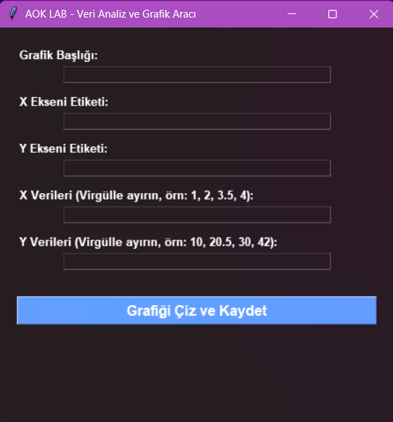
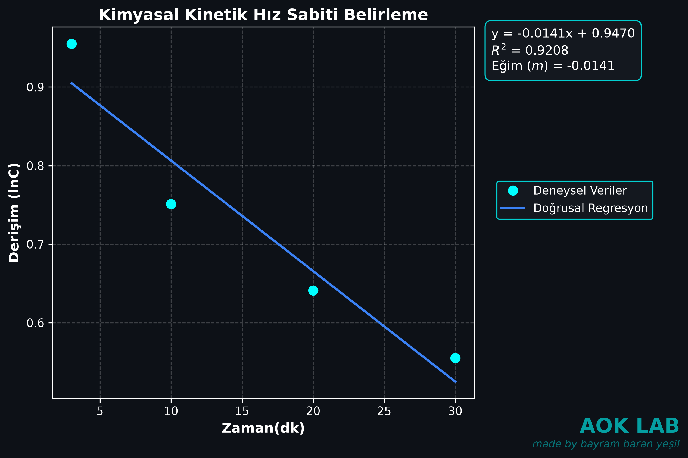

# AOK LAB GRAPH— Veri Analiz ve Grafik Aracı

**AOK LAB GRAPH**, deneysel verilerin görselleştirilmesi ve doğrusal regresyon analizi için Python ile geliştirilmiş bir masaüstü uygulamasıdır.

Uygulama; X ve Y verilerinin girilmesini, deneysel verilerin grafik üzerinde gösterilmesini, doğrusal regresyon hesaplamalarının yapılmasını ve oluşturulan grafiklerin yüksek çözünürlüklü PNG formatında kaydedilmesini sağlar.

## Özellikler

- **Grafiksel Kullanıcı Arayüzü:** Tkinter ile geliştirilmiş sade ve kullanımı kolay arayüz.
- **Deneysel Veri Görselleştirme:** X ve Y verilerini grafik üzerinde noktalar hâlinde gösterme.
- **Doğrusal Regresyon:** En iyi uyum doğrusunun eğimini ve y-kesişimini hesaplama.
- **İstatistiksel Analiz:** Belirleme katsayısını (\(R^2\)) hesaplama.
- **Özelleştirilebilir Grafikler:** Grafik başlığını ve eksen etiketlerini değiştirebilme.
- **Yüksek Çözünürlüklü Çıktı:** Grafikleri 300 DPI çözünürlükte PNG formatında kaydetme.
- **Koyu Tema:** Siyah arka plan, camgöbeği ve mavi tonlarıyla tasarlanmış grafikler.
- **Bağımsız Windows Uygulaması:** Python kurulumu gerektirmeyen, EXE formatında dağıtılabilen sürüm.

## Ekran Görüntüsü




## Örnek Grafik 

## Kullanılan Teknolojiler

| Teknoloji | Kullanım amacı |
|---|---|
| Python | Uygulamanın geliştirilmesi |
| Tkinter | Grafiksel kullanıcı arayüzü |
| NumPy | Sayısal işlemler |
| Matplotlib | Grafiklerin oluşturulması |
| SciPy | Doğrusal regresyon analizi |
| PyInstaller | Python uygulamasının EXE formatına dönüştürülmesi |

## İndirme ve Kurulum

### Windows kullanıcıları

Python kurmadan uygulamayı kullanmak için:

1. GitHub deposunun **Releases** bölümüne girin.
2. En güncel sürümdeki `AOK-LAB.exe` dosyasını indirin.
3. İndirdiğiniz dosyayı çalıştırın.

Uygulamanın paketlenmiş EXE sürümünü çalıştırmak için ayrıca Python kurulması gerekmez.

> **Güvenlik notu:** Windows, dijital olarak imzalanmamış uygulamalar için güvenlik uyarısı gösterebilir. Yalnızca güvendiğiniz kaynaklardan indirdiğiniz dosyaları çalıştırın.

## Kullanım

1. AOK LAB uygulamasını başlatın.
2. Grafik başlığını girin.
3. X ve Y eksenleri için etiketleri belirleyin.
4. X verilerini virgülle ayırarak girin.
5. Karşılık gelen Y verilerini aynı şekilde girin.
6. **Grafiği Çiz ve Kaydet** düğmesine basın.
7. Oluşturulan grafiği ve regresyon sonuçlarını inceleyin.
8. Grafiği PNG formatında kaydedin.

### Örnek Veri Seti

**X verileri:**

```text
1, 2, 3, 4, 5
```

**Y verileri:**

```text
2.1, 4.0, 6.2, 7.9, 10.1
```

X ve Y veri kümelerindeki değer sayıları eşit olmalıdır. Ondalık sayılar girilirken virgül yerine nokta kullanılmalıdır.

### Oluşturulan Grafik

Grafik üzerinde aşağıdaki bilgiler gösterilir:

- Deneysel veri noktaları
- Doğrusal regresyon doğrusu
- Regresyon denklemi
- Eğim (\(m\))
- Belirleme katsayısı (\(R^2\))
- Kullanıcının belirlediği grafik başlığı ve eksen etiketleri

Grafik dosyası şu adla kaydedilir:

```text
AOK_Genel_Grafik.png
```

Grafikler 300 DPI çözünürlükte kaydedilir.

## Kaynak Kodundan Çalıştırma

Uygulamayı Python üzerinden çalıştırmak veya geliştirmek isteyen kullanıcılar aşağıdaki adımları izleyebilir.

### Gereksinimler

- Python 3
- pip

### 1. Depoyu klonlayın

```bash
git clone https://github.com/YOUR_USERNAME/AOK-LAB.git
cd AOK-LAB
```

`YOUR_USERNAME` kısmını GitHub kullanıcı adınızla değiştirin.

### 2. Sanal ortam oluşturun

```bash
python -m venv .venv
```

Sanal ortamı Windows PowerShell üzerinden etkinleştirin:

```powershell
.\.venv\Scripts\Activate.ps1
```

### 3. Bağımlılıkları yükleyin

```bash
python -m pip install -r requirements.txt
```

### 4. Uygulamayı çalıştırın

```bash
python main.py
```

## EXE Dosyasını Yeniden Oluşturma

Uygulamayı kaynak kodundan derlemek için PyInstaller kullanılır.

Öncelikle PyInstaller'ı yükleyin:

```bash
python -m pip install pyinstaller
```

Ardından aşağıdaki komutu çalıştırın:

```bash
pyinstaller --onefile --window#
